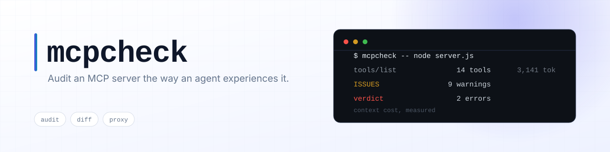
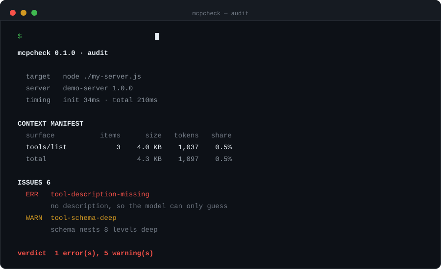

<p align="center">
  <picture>
    <source media="(prefers-color-scheme: dark)" srcset="assets/banner.svg">
    <source media="(prefers-color-scheme: light)" srcset="assets/banner-light.svg">
    
  </picture>
</p>

<h1 align="center">mcpcheck</h1>

<p align="center">
  <b>Audit an MCP server the way an agent experiences it — and cap what it costs you.</b>
</p>

<p align="center">
  
</p>

An MCP server's `tools/list` response is re-sent on *every single turn*. A server that
ships 14 tools with 12 KB of schema burns ~3,000 tokens of your context window before
you have asked a single question. `mcpcheck` measures that, tells you what an agent
will actually trip over, and gives you a proxy that caps oversized tool output at
runtime.

## Install

```bash
npm install -g mcpcheck     # or: npx mcpcheck -- <command>
```

From source:

```bash
git clone <repo> && cd mcpcheck
npm install
npm run build
node dist/index.js --help
```

Requires Node 18+. Zero runtime dependencies.

## Commands

| Command | What it does |
|---|---|
| `mcpcheck -- <cmd> [args]` | Audit the server (same as `mcpcheck audit`) |
| `mcpcheck diff <baseline.json> -- <cmd>` | Compare a saved baseline against the current server |
| `mcpcheck proxy -- <cmd> [args]` | Transparent stdio proxy that caps oversized tool output |

### Audit options

| Flag | Default | Meaning |
|---|---|---|
| `--json` | off | Machine-readable report |
| `--save <path>` | off | Also write the report to a file (use it as a diff baseline) |
| `--strict` | off | Exit 1 on warnings too |
| `--timeout <ms>` | `10000` | Per-request timeout |
| `--max-manifest-tokens <n>` | `10000` | Context budget for the whole manifest |
| `--max-tool-bytes <n>` | `4096` | Per-tool size budget |
| `--max-tool-depth <n>` | `4` | Schema nesting budget |
| `--context-window <n>` | `200000` | Denominator for the `share` column |

### Proxy options

| Flag | Default | Meaning |
|---|---|---|
| `--max-chars <n>` | `8000` | Cap each text block inside a tool result (`0` disables) |
| `--stats-file <path>` | off | Write final usage stats as JSON |
| `--quiet` | off | Suppress the stats summary |

## What it checks

The audit only **reads** the manifest — it never calls your tools, so it cannot
trigger side effects.

**Context cost** (the part nobody measures)

- Total size and estimated tokens of `tools/list`, `resources/list`, `prompts/list`
- Per-tool weight, so you can see which one dominates
- Share of a 200k context window

**Agent correctness**

- Tool with no description (error) or a one-liner under 12 chars (warn)
- Parameters without descriptions
- `inputSchema` over budget or nested deeper than 4 levels
- Tool names that are not `[a-zA-Z0-9_-]`
- Duplicate tool names

**Protocol hygiene**

- Non-JSON lines on stdout (breaks every stdio client)
- Responses with an unknown `id` (orphans)
- Slow `initialize`, missing `serverInfo`, protocol version mismatch
- Server dying before shutdown

## Diff: catch breaking changes in CI

```bash
# once, commit the baseline
mcpcheck audit --json --save baseline.json -- node ./my-server.js

# on every build
mcpcheck diff baseline.json -- node ./my-server.js
```

```
mcpcheck 0.1.0 · diff

  before   demo-server 1.0.0 · 3 tools · 1,097 tokens
  after    demo-server 1.0.0 · 3 tools · 1,097 tokens

BREAKING 3
  tool-removed     no_description_here — removed — any prompt that learned it now calls a method that does not exist
  param-required   query_database — now required: mode
  enum-narrowed    query_database — mode no longer accepts: write

COMPATIBLE 1
  tool-added       delete_rows — added (+120 tokens in every prompt)
verdict  3 breaking change(s)
```

Classified as **breaking**: a tool disappears, a parameter disappears, a parameter
becomes required, a new required parameter appears, or an enum loses a value.
Everything else (added tools, relaxed params, description rewording, weight changes)
is reported as compatible or informational.

## Proxy: cap tool output at runtime

Point your MCP client at the proxy instead of the server:

```jsonc
// claude_desktop_config.json / mcp.json
{
  "mcpServers": {
    "filesystem": {
      "command": "mcpcheck",
      "args": ["proxy", "--max-chars", "8000", "--", "npx", "-y",
               "@modelcontextprotocol/server-filesystem", "."]
    }
  }
}
```

The proxy passes every byte through untouched unless a JSON-RPC response exceeds
`--max-chars`, in which case it truncates `result.content[].text` blocks and appends
`…[mcpcheck truncated N chars]`. The result stays valid JSON, `structuredContent`
is left alone, and you get a bill at the end:

```
mcpcheck proxy · 42 req / 42 res · 1.4 MB in → 320 KB out · 9 truncated · ~24k tokens kept out of context
```

## Exit codes

| Code | Meaning |
|---|---|
| `0` | Clean (no errors, or only warnings without `--strict`) |
| `1` | Errors found, breaking diff changes, or warnings with `--strict` |
| `2` | Could not run (bad usage, spawn failure, missing report file) |

## How it works

```
src/
  client.ts    MCP stdio client: newline-delimited JSON-RPC, request-level timeouts,
               exit-aware failure, stdout pollution counters, Windows .cmd shims
  audit.ts     handshake + manifest collection + the checks above
  diff.ts      baseline comparison (breaking vs compatible)
  proxy.ts     bidirectional stdio pump with per-response truncation
  report.ts    terminal rendering (colors auto-disabled when not a TTY)
  tokens.ts    byte/token estimation — no tokenizer dependency
  ui.ts        ANSI helpers, padding, flag parsing helpers
  args.ts      zero-dependency argv parser
```

Design rules worth knowing:

- **Never blocks forever.** Every request carries a timeout; if the server exits, all
  pending requests fail immediately with the tail of stderr attached.
- **Token counts are estimates** (~4 ASCII chars or ~1.5 CJK chars per token). They are
  meant for comparing two servers against each other, not for billing.
- **Nothing is uploaded.** No network calls at all.
- **Windows is a first-class target.** `spawn` does not resolve `PATHEXT` and cannot run
  `.cmd` directly, so commands like `npx` are re-launched through
  `cmd /d /s /c` with the whole line quoted — otherwise `C:\Program Files\...` breaks.

## Development

```bash
npm install
npm test          # tsc + smoke tests against a deliberately broken MCP server
```

The banner and the animated demo are generated, not hand-drawn:

```bash
node scripts/make-assets.js   # writes assets/banner.svg, banner-light.svg, demo.svg
```

Animated SVG instead of a GIF: text stays sharp at any zoom and on any DPI, the file is
~6 KB instead of a few MB, and it follows the reader's light/dark theme.

`scripts/demo-server.js` is an MCP server that pollutes stdout, has a tool without a
description, and nests its schema 8 levels deep. `scripts/smoke.js` asserts that the
audit catches all of it and that the proxy still emits parseable JSON after truncation.

## Limitations

- Token counts are heuristic, not tokenizer-accurate.
- `proxy` only truncates `result.content[].text`; `structuredContent` and non-text
  content blocks pass through at full size.
- `initialize` timing includes launcher overhead (`npx`, `pnpm`, …), so a cold
  `npx` run can look slow.
- Diff compares saved reports, so a baseline taken with different `--max-*` thresholds
  can produce noise.

## License

MIT
